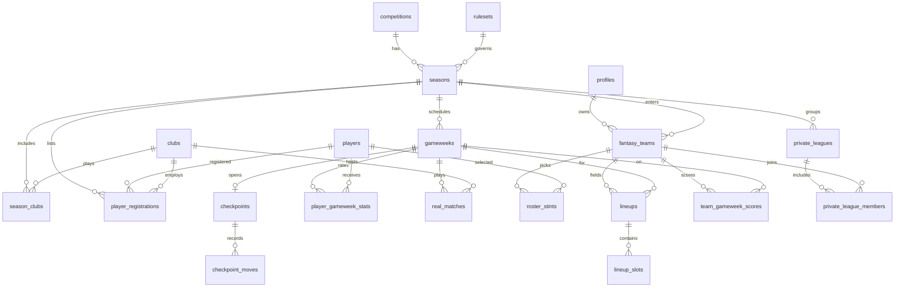

# Fantaventi — Product Requirements Document

| Campo | Valore |
| --- | --- |
| Prodotto | Fantaventi |
| Tipo | Web app e mobile app di fantacalcio |
| Versione documento | 0.1 |
| Stato | Bozza di specifica, senza codice applicativo |
| Mercato | Europa, prima competizione Serie A |
| Modello | Gratuito, senza premi, aperto a tutti |

## 1. Scopo

Fantaventi è un fantacalcio gratuito in cui ogni squadra costruisce una rosa con esattamente un calciatore per ciascun club della competizione e schiera una formazione a ogni giornata. Il backend calcola il punteggio di giornata con il voto base, i bonus e i malus, il modificatore del capitano, il fair play, il modificatore difesa e la riserva d'ufficio.

Questo documento fissa le regole di business e il modello dati. Non descrive ancora schermate, API o codice.

### 1.1 Obiettivi

- Applicare in modo deterministico il regolamento Fantaventi.
- Conservare rosa, formazione e punteggi per giornata, così un risultato già pubblicato si può rispiegare e ricalcolare.
- Consentire più lingue e, in seguito, più competizioni europee senza riscrivere lo schema.
- Tenere traccia della fonte voti (fantacalcio.it, fonte Napoli).

### 1.2 Fuori ambito di questa versione

- Premi, quote, pagamenti, scommesse.
- Asta, budget e scambi tra utenti. Il mercato è solo il check-point regolamentare.
- Chat, notifiche push e classifica social oltre alla classifica di stagione e ai gruppi privati.
- Client web e mobile. Il contratto condiviso è il database descritto qui.

## 2. Principi di prodotto

1. **Una rosa per utente e stagione.** Ogni persona partecipa a una competizione con una sola squadra.
2. **La competizione è un dato, non una costante.** Serie A è la prima riga di `competitions`, con 20 club. Il vincolo «un calciatore per club» vale per i club di quella stagione.
3. **Il regolamento è versionato.** Soglie, bonus e malus stanno in un ruleset. Una giornata chiusa resta agganciata alla versione con cui è stata calcolata.
4. **I punti sono spiegabili.** Si salva il totale e ogni componente: voto, bonus, malus, capitano, fair play, difesa, riserva.
5. **Le stringhe utente non sono testi fissi nel database.** Nomi di club, competizioni e bonus hanno traduzioni. La lingua dell'interfaccia è una preferenza del profilo.

## 3. Glossario

| Termine | Significato |
| --- | --- |
| Rosa | I calciatori posseduti da una squadra in una giornata. In Serie A sono sempre 20. |
| Titolare | Calciatore inserito nella formazione della giornata. Al massimo 11. |
| Voto | Voto base pubblicato dalla fonte, a passi di 0,5. Non include bonus e malus. |
| Punteggio giocatore | Voto + bonus + malus, con malus raddoppiati se il giocatore è capitano effettivo. |
| Capitano effettivo | Il capitano, oppure il vice se il capitano non ha voto. |
| Check-point | Finestra di mercato in cui una squadra può sostituire fino a 4 calciatori. |
| Ruleset | Insieme versionato dei parametri di calcolo. |

## 4. Attori

- **Partecipante:** crea la squadra, compone la rosa, usa i check-point, schiera la formazione, consulta i punteggi.
- **Amministratore di competizione:** crea stagione, club, listone, giornate, check-point e importa i voti. Può riaprire una giornata non ancora definitiva.
- **Motore di calcolo:** job interno. Non è un ruolo umano. Legge voti e ruleset e scrive i punteggi.

## 5. Regole di business

Gli identificativi (`ROS`, `FOR`, `SCO`, `MKT`, `CLS`) sono il riferimento per i test futuri.

### 5.1 Rosa

**ROS-01.** Una squadra ha, in ogni giornata, esattamente un calciatore per ciascun club della stagione. In Serie A i club sono 20, quindi la rosa è di 20 calciatori.

**ROS-02.** I portieri in rosa sono minimo 2 e massimo 3.

**ROS-03.** Per ciascuno dei ruoli di movimento (difensore, centrocampista, attaccante) i calciatori in rosa sono minimo 3 e massimo 9.

**ROS-04.** I quattro vincoli precedenti valgono insieme. Con 2 portieri restano 18 giocatori di movimento; con 3 portieri ne restano 17. Esempi validi: 2-9-6-3, 2-6-6-6, 3-5-5-4, 3-9-4-4. Esempio non valido: 2-10-5-3, perché i difensori superano 9.

**ROS-05.** Ruolo e club usati nei controlli sono quelli del listone validi per quella giornata. Un passaggio di club nel calcio reale cambia il club di riferimento dalla giornata di effetto in poi.

**ROS-06.** La rosa iniziale si crea prima della prima giornata, senza il limite dei 4 cambi. Dalla creazione in poi ROS-01…ROS-04 sono sempre veri: non esiste una rosa «provvisoria» non valida.

**ROS-07.** Non c'è budget. Qualsiasi calciatore del listone è selezionabile se il risultato rispetta i vincoli.

**ROS-08.** Durante la giornata in corso la rosa non si modifica: niente acquisti, cessioni o cambi. Il blocco parte dal calcio d'inizio della prima partita e termina al fischio finale dell'ultima. Se il calendario ha solo gli orari, senza lo stato della partita, il blocco termina due ore dopo l'ultimo calcio d'inizio. Fuori da quella finestra la rosa si può rifare, e al salvataggio valgono comunque ROS-01…ROS-04.

### 5.2 Formazione

**FOR-01.** Per ogni giornata la squadra schiera da 0 a 11 titolari, tutti presenti in rosa per quella giornata.

**FOR-02.** Un titolare compare una sola volta.

**FOR-03.** La formazione ha un capitano e un vice, distinti, entrambi titolari. Se i titolari sono meno di 2, il vice è assente; se è presente un solo titolare, quel titolare è il capitano.

**FOR-04.** La formazione si blocca alla scadenza della giornata. Dopo il lock non si modifica più, salvo riapertura di un amministratore prima dello stato `final`.

**FOR-05.** La panchina è un elenco ordinato, distinto dai titolari. L'ordine è quello della lista, non un raggruppamento per ruolo. Se un titolare non ha voto, entra il primo panchinaro dello stesso ruolo che ha voto. Il portiere può essere sostituito solo da un portiere. Se non c'è un panchinaro di quel ruolo, entra il primo panchinaro di un altro ruolo, nell'ordine della lista, purché la formazione resti dentro un modulo di FOR-06. Chi entra prende i propri punti e non diventa capitano: se il capitano non ha voto, modificatore e malus raddoppiati restano al vice. Un panchinaro che non entra non prende punti. Se nessuno può entrare, il posto resta vuoto e vale la riserva d'ufficio.

**FOR-06.** I titolari stanno dentro uno di questi moduli, sempre con al massimo un portiere: 3-4-3, 3-5-2, 4-3-3, 4-4-2, 4-5-1, 5-3-2, 5-4-1. Con 11 titolari il modulo è completo e il portiere è obbligatorio. Con meno di 11 i posti vuoti restano nel modulo scelto. Lo stesso vincolo vale dopo un cambio modulo dalla panchina: i conteggi dei ruoli in campo devono stare dentro uno di questi moduli.

### 5.3 Motore di punteggio

Fonte voti: fantacalcio.it, fonte Napoli. Il voto assente è `NULL`, non `0`. Un voto `0` non è un valore previsto.

#### Componenti del singolo titolare

**SCO-01.** Se il titolare non ha voto, il suo contributo è nullo: non entra nella somma, non è «a voto», non alimenta fair play né modificatore difesa.

**SCO-02.** Se il titolare ha voto e non è capitano effettivo:

`punti = voto + bonus + malus`

I malus sono già numeri negativi.

**SCO-03.** Se il titolare è capitano effettivo:

`punti = voto + bonus + (malus × 2)`

Si raddoppia solo la somma dei malus personali. I bonus non si raddoppiano. Il voto non si moltiplica.

**SCO-04.** Il modificatore capitano è un bonus di squadra additivo, scelto sul voto base del capitano effettivo:

| Voto base | Modificatore di squadra |
| --- | ---: |
| minore di 6 | −0,5 |
| 6 | +0,5 |
| 6,5 | +1 |
| 7 | +1,5 |
| 7,5 o superiore | +2 |

Il voto Fantaventi è pubblicato a passi di mezzo punto, quindi la tabella copre i valori attesi. Un voto fuori scala non viene arrotondato in silenzio: il calcolo della giornata va in errore e resta non pubblicato.

**SCO-05.** Il modificatore si somma al totale di squadra. Non modifica il punteggio individuale mostrato come «voto fantacalcio» del capitano, che resta quello di SCO-03. In interfaccia vanno mostrate entrambe le righe.

**SCO-06.** Il vice diventa capitano effettivo solo se il capitano non ha voto e il vice ha voto. In quel caso riceve malus raddoppiati e sblocca il modificatore di squadra. Se neanche il vice ha voto, non c'è capitano effettivo: nessun raddoppio e modificatore 0.

**SCO-07.** Fair play: `+2,5` se almeno un titolare ha voto e nessuno dei titolari a voto ha un'ammonizione. Se nessun titolare ha voto, il fair play è 0. Un'espulsione diretta, senza ammonizione, non toglie il fair play finché il punto non è confermato (sezione 10).

**SCO-08.** Modificatore difesa, calcolato solo sui titolari:

1. Il portiere titolare ha un voto.
2. Almeno 4 difensori titolari hanno un voto.
3. Si prendono il portiere e i 3 difensori con il valore più alto.
4. `media = (valore portiere + somma dei 3 difensori) / 4`.
5. Soglie, inclusive:

| Media | Modificatore |
| --- | ---: |
| minore di 6,0 | 0 |
| ≥ 6,0 e < 6,5 | +1 |
| ≥ 6,5 e < 7,0 | +3 |
| ≥ 7,0 | +6 |

Il valore usato nella media è il **voto base**, non il punteggio con bonus e malus. È un'ipotesi esplicita: il regolamento cita il «voto» per il capitano e il «punteggio» per la difesa. Il default è il voto base, allineato al modificatore difesa classico e al fatto che un gol (+3) non deve gonfiare la media. Il ruleset ha il campo `defense_rating_basis` (`voto` oppure `fantavoto`) così la scelta si può invertire senza migrazione strutturale.

A parità di valore, il difensore «migliore» si decide in modo stabile: fantavoto più alto, poi `player_id` crescente. La scelta del pari non cambia la media se la base è il voto, ma rende il risultato ripetibile.

**SCO-09.** Riserva d'ufficio: ogni posto rimasto vuoto vale 2,5.

`riserva = 2,5 × posti vuoti`

Un posto è vuoto se non è stato schierato, oppure se il titolare non ha voto e nessun panchinaro può entrare al suo posto secondo FOR-05. Un titolare senza voto che viene sostituito non lascia un posto vuoto. Undici schierati, tutti sostituiti o a voto, producono riserva 0. Tre difensori di cui uno senza voto e senza un ingresso possibile producono un posto vuoto, quindi 2,5.

**SCO-10.** Totale di giornata:

`totale = somma punti dei titolari a voto + modificatore capitano + fair play + modificatore difesa + riserva`

**SCO-11.** Tutti i punti sono `numeric`, con una cifra decimale per i voti e due per i totali di squadra. Non si usa il virgola mobile binario.

**SCO-12.** Il calcolo è ripetibile. A parità di rosa, formazione, voti e ruleset, il totale è identico. Una giornata in stato `final` non viene ricalcolata. Un ricalcolo in stato `scored` sovrascrive le righe di quella giornata e conserva il ruleset usato.

#### Catalogo bonus e malus

I valori segnati come fissi arrivano dal regolamento. Gli altri sono default operativi, disattivabili o modificabili nel ruleset prima del calcio d'inizio. Il motore non ha numeri scritti nel codice: legge questo catalogo.

| Codice | Tipo | Punti default | Origine |
| --- | --- | ---: | --- |
| `yellow_card` | malus | −0,5 | regolamento |
| `red_card` | malus | −1 | regolamento |
| `goal` | bonus | +3 | da confermare |
| `assist` | bonus | +1 | da confermare |
| `penalty_scored` | bonus | +3 | da confermare; in alternativa il rigore segnato è già contato in `goal` e questo codice vale 0 |
| `penalty_missed` | malus | −3 | da confermare |
| `penalty_saved` | bonus | +3 | da confermare |
| `own_goal` | malus | −2 | da confermare |
| `goal_conceded` | malus | −1 | da confermare, di norma solo portiere |

`is_malus = true` è la condizione tecnica del raddoppio capitano. Aggiungere un malus futuro non richiede una modifica di schema.

#### Esempi di controllo

**Capitano con gol e ammonizione.** Voto 7, un gol (+3), un'ammonizione (−0,5).

- Punti giocatore: `7 + 3 + (−0,5 × 2) = 9`
- Modificatore di squadra: `+1,5`
- Il gol non viene raddoppiato.

**Capitano senza voto.** Il capitano non ha voto. Il vice ha voto 6,5 e un autogol (−2).

- Il vice è capitano effettivo.
- Punti del vice: `6,5 + (−2 × 2) = 2,5`
- Modificatore di squadra: `+1`
- Il capitano originale contribuisce 0.

**Difesa.** Portiere 6,5. Difensori a voto: 7, 6,5, 6, 5,5. Il quinto difensore non ha voto, ma i difensori a voto sono 4, quindi il modificatore si calcola. I tre migliori sono 7, 6,5 e 6.

- Media: `(6,5 + 7 + 6,5 + 6) / 4 = 6,5`
- Modificatore: `+3`

**Rosa incompleta in formazione.** Nove titolari, tutti con voto, nessun altro bonus di squadra. Riserva: `2,5 × 2 = 5`, sommati ai nove punteggi.

**Fair play.** Undici titolari, otto a voto, nessuna ammonizione tra quegli otto. Fair play `+2,5`, anche se tre titolari non hanno voto. Se uno degli otto ha un giallo, fair play 0.

### 5.4 Mercato e check-point

**MKT-01.** La rosa della prima giornata si forma prima del campionato e non consuma check-point.

**MKT-02.** Dalla seconda giornata la stagione ha esattamente 3 check-point.

**MKT-03.** Ogni check-point è agganciato a una giornata distinta, di numero ≥ 2. Non si possono usare due check-point nella stessa giornata e i cambi non usati non si accumulano sul check-point successivo.

**MKT-04.** In un check-point una squadra sostituisce da 0 a 4 calciatori. Una sostituzione è una coppia: un uscente e un entrante.

**MKT-05.** L'entrante può avere un ruolo diverso dall'uscente.

**MKT-06.** Il controllo dei vincoli avviene sulla rosa risultante, in un'unica transazione. Uno stato intermedio invalido è ammesso solo dentro la transazione; al commit la rosa rispetta ROS-01…ROS-04.

**MKT-07.** La nuova rosa vale dalla giornata del check-point in poi, fino al check-point successivo. La formazione di quella giornata può usare solo la rosa nuova.

**MKT-08.** Le giornate dei 3 check-point non sono decise dal partecipante. Le configura l'amministratore di stagione prima dell'avvio. Lo schema non le fissa nel codice.

### 5.5 Classifica

La classifica di un gruppo privato è una **somma di punti reali**. La media non è il punteggio di chi gioca dall'inizio.

**CLS-01.** Chi è in lega dalla prima giornata utile del range (`start_matchday`) somma i punti reali delle giornate del range già chiuse. Una giornata è chiusa quando `deadline_at` è stata raggiunta, oppure lo stato è `locked`, `scored` o `final`. Manca la riga di punteggio: quella giornata vale 0. Non c'è punteggio d'ingresso.

**CLS-02. Ingresso in Media.** La giornata di ingresso X è la prima giornata del range in cui la squadra ha una formazione. Se X è successiva a `start_matchday`, la squadra riceve un **Punteggio d'Ingresso** figurativo e poi prosegue a somma di punti reali:

- le giornate saltate sono quelle del range già chiuse, da `start_matchday` a X − 1;
- le giornate disputate sono quelle del range già chiuse, da X in poi, in cui la squadra ha schierato una formazione;
- la media è la somma dei punti reali delle giornate disputate divisa per il loro numero;
- il Punteggio d'Ingresso è `media × giornate saltate`;
- i punti di classifica sono `Punteggio d'Ingresso + somma dei punti reali delle giornate disputate`.

Finché non esiste almeno una giornata disputata, la media non esiste e il Punteggio d'Ingresso resta 0. Una giornata chiusa dopo l'ingresso, ma senza formazione, non entra nella media e non aggiunge punti.

**CLS-03.** Una squadra iscritta che non ha ancora una formazione nel range è trattata come presente da `start_matchday`: solo punti reali, nessun Ingresso in Media.

**CLS-04.** A parità di punti di classifica, l'ordine è: punti reali più alti, poi nome squadra.

**CLS-05.** Il gruppo privato filtra le squadre della stessa stagione. La rosa resta unica: il gruppo non ha un mercato separato. Il calcolo ufficiale è `league_standings(p_league_id)` in `league_hub.sql`.

**CLS-06.** La classifica live usa la stessa formula. Per la giornata in corso sostituisce il totale ufficiale con `provisional_total` delle righe `is_live`. Le giornate già `final` restano sui punti ufficiali.

### 5.6 Live score e partite reali

Il weekend non aspetta il voto di tutte le squadre. I punti provvisori si aggiornano partita per partita.

**LIV-01.** `real_matches` è la partita reale di una giornata: club di casa, club in trasferta, calcio d'inizio e stato `scheduled`, `live` o `finished`. La stessa coppia di club non si ripete nella giornata. Il live score associa ogni calciatore al club della sua registrazione valida in quella giornata.

**LIV-02.** Durante il weekend l'amministratore carica uno o più file Excel dei voti, anche parziali (venerdì, sabato, domenica). L'import aggiorna solo i calciatori con un voto valorizzato, compreso un testo come `6*`. Chi non ha ancora voto resta `NULL` e non viene azzerato da un file successivo che non lo contiene.

**LIV-03.** Ogni file produce una riga in `vote_imports` con `payload_hash` (SHA-256 dei byte). Lo stesso file sulla stessa giornata è rifiutato. Un file diverso, anche parziale, è un nuovo import.

**LIV-04.** Dopo ogni import parte il calcolo provvisorio. `calculateProvisional` somma solo i titolari la cui partita è `finished` oppure che hanno già un voto in `player_gameweek_stats`. I titolari ancora in campo non entrano nel totale e non consumano la riserva d'ufficio: la riserva resta riservata agli slot vuoti. Il modificatore difesa scatta solo se portiere e almeno quattro difensori hanno già voto. Il fair play scatta solo quando nessun titolare è ancora in campo. Il risultato è `provisional_total`, con `rated_players_count` e `on_pitch_count`. `is_live` resta vero finché la giornata non è calcolata in modo definitivo.

**LIV-05.** In lega la classifica ha due viste. Quella ufficiale segue la sezione 5.5 e legge `total`. Quella live, per la giornata ancora non `final`, legge `provisional_total` dove `is_live` è vero e mostra il badge `votati / 11` insieme a quanti titolari sono ancora in campo.

**LIV-06.** Una giornata `final` rifiuta nuovi import, nuovi voti e nuovi punteggi. Il blocco è un trigger sul database, non solo un controllo dell'API.

## 6. Internazionalizzazione e scala europea

- Locale del profilo in formato BCP 47 (`it` di default, poi `en`, `es`, `fr`, `de`).
- Traduzioni persistite per competizione, club, ruolo e tipo di bonus. I nomi dei calciatori restano nella forma ufficiale della fonte.
- I testi dell'interfaccia vivranno nei client, con chiavi, non in questo schema.
- Date e fusi: `timestamptz` in UTC. La scadenza di giornata è un istante, mostrato nel fuso dell'utente.
- La prima competizione è `serie_a`. Una seconda lega europea è una nuova competition, una nuova stagione, un nuovo listone e, se serve, un ruleset diverso. Le tabelle fantacalcio non cambiano.
- `squad_size` del ruleset deve coincidere con il numero di club della stagione. Per la Serie A è 20. Il vincolo «un club, un calciatore» è generale.

## 7. Requisiti non funzionali

- **Integrità:** i vincoli di rosa non dipendono solo dal client. Il database rifiuta la transazione non valida.
- **Tracciabilità:** ogni import voti ha fonte, istante e hash del payload.
- **Riproducibilità:** giornata finale immutabile; ruleset collegato al punteggio.
- **Privacy:** account tramite Supabase Auth. Il profilo pubblico espone solo il nome squadra e i risultati. Email e identità restano sul profilo privato. Residenza dati nell'Unione Europea quando il progetto Supabase verrà creato.
- **Prestazioni attese:** il calcolo di una giornata è un job batch, non una query eseguita a ogni apertura di classifica. La classifica legge punteggi già scritti.
- **Concorrenza:** due salvataggi di formazione per la stessa squadra e giornata non creano due formazioni. Stesso comportamento per la rosa.

## 8. Modello dati

PostgreSQL, pensato per Supabase. Chiavi primarie `uuid`. I punti sono `numeric`. Lo schema è in `public`; gli utenti di Auth restano in `auth.users`.

### 8.1 Vista d'insieme



### 8.2 Enumerazioni

```sql
create type player_role as enum ('GK', 'DEF', 'MID', 'FWD');

create type season_status as enum ('draft', 'open', 'running', 'closed');

create type gameweek_status as enum (
  'scheduled', -- creata, formazione non ancora apribile
  'open',      -- formazione e, se previsto, check-point aperti
  'locked',    -- scadenza passata, in attesa voti
  'scored',    -- punteggi scritti, ancora ricalcolabili
  'final'      -- immutabile
);

create type lineup_status as enum ('draft', 'locked');

create type match_status as enum ('scheduled', 'live', 'finished');
```

### 8.3 Identità

```sql
create table profiles (
  id            uuid primary key references auth.users (id) on delete cascade,
  display_name  text not null,
  locale        text not null default 'it',
  created_at    timestamptz not null default now()
);
```

`profiles` è la scheda applicativa. Non si duplica l'email di Auth.

### 8.4 Competizione, stagione, regolamento

```sql
create table competitions (
  id            uuid primary key,
  code          text not null unique,          -- 'serie_a'
  country_code  char(2) not null,
  created_at    timestamptz not null default now()
);

create table competition_translations (
  competition_id uuid not null references competitions (id),
  locale         text not null,
  name           text not null,
  primary key (competition_id, locale)
);

create table rulesets (
  id         uuid primary key,
  code       text not null,                    -- 'fantaventi'
  version    integer not null,
  definition jsonb not null,
  unique (code, version)
);

create table seasons (
  id              uuid primary key,
  competition_id  uuid not null references competitions (id),
  ruleset_id      uuid not null references rulesets (id),
  code            text not null,               -- '2026-27'
  status          season_status not null default 'draft',
  starts_on       date,
  ends_on         date,
  unique (competition_id, code)
);
```

`rulesets.definition` contiene i parametri, non i calciatori. Forma attesa:

```json
{
  "squad_size": 20,
  "goalkeepers": { "min": 2, "max": 3 },
  "outfield_roles": { "min": 3, "max": 9 },
  "lineup_size": 11,
  "captain_modifier": [
    { "max_exclusive": 6, "points": -0.5 },
    { "eq": 6, "points": 0.5 },
    { "eq": 6.5, "points": 1 },
    { "eq": 7, "points": 1.5 },
    { "min_inclusive": 7.5, "points": 2 }
  ],
  "double_captain_malus": true,
  "fair_play": { "points": 2.5, "cards": ["yellow_card"] },
  "defense_modifier": {
    "basis": "voto",
    "min_rated_defenders": 4,
    "best_defenders": 3,
    "bands": [
      { "min": 6.0, "points": 1 },
      { "min": 6.5, "points": 3 },
      { "min": 7.0, "points": 6 }
    ]
  },
  "empty_slot_points": 2.5,
  "checkpoints": { "count": 3, "first_gameweek": 2, "max_replacements": 4 },
  "bonus_malus": {
    "yellow_card": -0.5,
    "red_card": -1,
    "goal": 3,
    "assist": 1,
    "penalty_missed": -3,
    "penalty_saved": 3,
    "own_goal": -2,
    "goal_conceded": -1
  }
}
```

I default non confermati stanno nel JSON proprio perché devono poter cambiare prima del primo calcolo, senza alterare le tabelle.

### 8.5 Club, calciatori, listone

```sql
create table clubs (
  id              uuid primary key,
  competition_id  uuid not null references competitions (id),
  code            text not null,
  unique (competition_id, code)
);

create table club_translations (
  club_id    uuid not null references clubs (id),
  locale     text not null,
  name       text not null,
  short_name text not null,
  primary key (club_id, locale)
);

create table season_clubs (
  season_id uuid not null references seasons (id),
  club_id   uuid not null references clubs (id),
  primary key (season_id, club_id)
);

create table players (
  id            uuid primary key,
  external_ref  text unique,             -- id fantacalcio.it
  full_name     text not null
);

create table player_registrations (
  id                       uuid primary key,
  season_id                uuid not null references seasons (id),
  player_id                uuid not null references players (id),
  club_id                  uuid not null references clubs (id),
  role                     player_role not null,
  effective_from_gameweek  integer not null,
  effective_to_gameweek    integer,               -- null = fino a fine stagione
  unique (season_id, player_id, effective_from_gameweek)
);
```

`season_clubs` è l'elenco che rende vera la frase «uno per ciascun club»: per la Serie A deve contenere 20 righe e il ruleset deve avere `squad_size = 20`.

`player_registrations` è il listone. L'intervallo di giornate copre un trasferimento reale. La quotazione presente nel file Excel non è un parametro di gioco e non viene salvata: in rosa si sceglie un calciatore per club.

Un calciatore ceduto non si cancella: la riga aperta riceve `effective_to_gameweek` sull'ultima giornata in cui era tesserato. Il club nuovo, se arriva, apre un'altra riga da `effective_from_gameweek`. Il trigger `player_registrations_keep_history` rifiuta gli intervalli sovrapposti e un club fuori da `season_clubs`. Una riga con `effective_to_gameweek` precedente a `effective_from_gameweek` è chiusa prima di entrare in stagione e non copre alcuna giornata.

### 8.6 Calendario, check-point, voti

```sql
create table gameweeks (
  id          uuid primary key,
  season_id   uuid not null references seasons (id),
  number      integer not null check (number >= 1),
  deadline_at timestamptz not null,
  status      gameweek_status not null default 'scheduled',
  scored_at   timestamptz,                  -- inizio della finestra d'appello
  unique (season_id, number)
);

create table real_matches (
  id            uuid primary key,
  gameweek_id   uuid not null references gameweeks (id),
  home_club_id  uuid not null references clubs (id),
  away_club_id  uuid not null references clubs (id),
  kickoff_at    timestamptz not null,
  status        match_status not null default 'scheduled',
  unique (gameweek_id, home_club_id, away_club_id),
  check (home_club_id <> away_club_id)
);

create table checkpoints (
  id           uuid primary key,
  season_id    uuid not null references seasons (id),
  sequence     smallint not null check (sequence between 1 and 3),
  gameweek_id  uuid not null unique references gameweeks (id),
  opens_at     timestamptz not null,
  closes_at    timestamptz not null,
  unique (season_id, sequence),
  check (opens_at < closes_at)
);

create table vote_imports (
  id           uuid primary key,
  gameweek_id  uuid not null references gameweeks (id),
  source       text not null,             -- id dell'adapter, oppure 'mock'
  source_note  text not null default 'Napoli',
  payload_hash text not null,             -- SHA-256 del file o del payload
  imported_at  timestamptz not null default now()
);

create table player_gameweek_stats (
  id                uuid primary key,
  gameweek_id       uuid not null references gameweeks (id),
  player_id         uuid not null references players (id),
  vote_import_id    uuid not null references vote_imports (id),
  voto              numeric(3,1),          -- null = non ha voto
  goals             integer not null default 0,
  assists           integer not null default 0,
  yellow_cards      integer not null default 0,
  red_cards         integer not null default 0,
  penalties_scored  integer not null default 0,
  penalties_missed  integer not null default 0,
  penalties_saved   integer not null default 0,
  own_goals         integer not null default 0,
  goals_conceded    integer not null default 0,
  unique (gameweek_id, player_id),
  check (voto is null or voto between 0 and 10)
);
```

Il check-point punta a una giornata con `number >= 2`. Lo verifica un trigger perché il numero sta su `gameweeks`, non sulla riga del check-point. Tre sequence e la chiave unica su `gameweek_id` impediscono sia un quarto check-point sia due check-point sulla stessa giornata.

Se un calciatore non compare nell'import, non si inventa una riga con voto 0: l'assenza di riga e il `voto` nullo sono equivalenti per il motore («non ha voto»).

### 8.7 Squadre, rose, formazioni, punteggi

```sql
create table fantasy_teams (
  id         uuid primary key,
  user_id    uuid not null references profiles (id),
  season_id  uuid not null references seasons (id),
  name       text not null,
  created_at timestamptz not null default now(),
  unique (user_id, season_id)
);

create table roster_stints (
  id                       uuid primary key,
  fantasy_team_id          uuid not null references fantasy_teams (id),
  player_id                uuid not null references players (id),
  active_from_gameweek     integer not null,
  active_until_gameweek    integer,          -- null = ancora in rosa
  check (
    active_until_gameweek is null
    or active_until_gameweek >= active_from_gameweek
  )
);

create table checkpoint_moves (
  id               uuid primary key,
  checkpoint_id    uuid not null references checkpoints (id),
  fantasy_team_id  uuid not null references fantasy_teams (id),
  player_out_id    uuid not null references players (id),
  player_in_id     uuid not null references players (id),
  created_at       timestamptz not null default now(),
  check (player_out_id <> player_in_id)
);

create table lineups (
  id               uuid primary key,
  fantasy_team_id  uuid not null references fantasy_teams (id),
  gameweek_id      uuid not null references gameweeks (id),
  status           lineup_status not null default 'draft',
  locked_at        timestamptz,
  unique (fantasy_team_id, gameweek_id)
);

create table lineup_slots (
  lineup_id        uuid not null references lineups (id) on delete cascade,
  player_id        uuid not null references players (id),
  is_captain       boolean not null default false,
  is_vice_captain  boolean not null default false,
  primary key (lineup_id, player_id),
  check (not (is_captain and is_vice_captain))
);

create table team_gameweek_scores (
  fantasy_team_id     uuid not null references fantasy_teams (id),
  gameweek_id         uuid not null references gameweeks (id),
  ruleset_id          uuid not null references rulesets (id),
  players_points      numeric(6,2) not null,
  captain_modifier    numeric(4,2) not null,
  captain_player_id   uuid references players (id),
  fair_play           numeric(4,2) not null,
  defense_modifier    numeric(4,2) not null,
  defense_average     numeric(4,2),
  reserve_points      numeric(4,2) not null,
  total               numeric(6,2) not null,
  provisional_total   numeric(6,2),
  rated_players_count integer not null default 0,
  on_pitch_count      integer not null default 0,
  is_live             boolean not null default false,
  calculated_at       timestamptz not null default now(),
  primary key (fantasy_team_id, gameweek_id)
);

create table lineup_player_scores (
  fantasy_team_id      uuid not null,
  gameweek_id          uuid not null,
  player_id            uuid not null references players (id),
  voto                 numeric(3,1),
  bonus_points         numeric(5,2) not null,
  malus_points         numeric(5,2) not null,
  malus_factor         numeric(2,1) not null,   -- 1 oppure 2
  player_points        numeric(5,2),            -- null se non ha voto
  is_effective_captain boolean not null,
  primary key (fantasy_team_id, gameweek_id, player_id),
  foreign key (fantasy_team_id, gameweek_id)
    references team_gameweek_scores (fantasy_team_id, gameweek_id)
    on delete cascade
);
```

`roster_stints` è lo storico. La rosa della giornata N è l'insieme delle righe con `active_from_gameweek <= N` e (`active_until_gameweek` nullo oppure `>= N`). Un cambio al check-point della giornata 12 chiude lo stint dell'uscente a 11 e apre quello dell'entrante a 12. Così la giornata 11 resta spiegabile anche a stagione inoltrata.

`checkpoint_moves` è il giornale dei cambi, non la rosa. Il limite di 4 è un trigger su questo giornale. I cambi iniziali della prima giornata non passano di qui.

`lineup_player_scores` è il dettaglio che permette di mostrare perché un titolare vale quei punti, incluso il fattore 2 sui malus.

`total` è il punteggio ufficiale. `provisional_total` è il live score. `is_live` è vero finché quel totale ufficiale non è stato pubblicato. `rated_players_count` e `on_pitch_count` alimentano il badge, per esempio `8/11 votati` e `3 in campo`.

### 8.8 Gruppi privati

```sql
create table private_leagues (
  id            uuid primary key,
  season_id     uuid not null references seasons (id),
  owner_user_id uuid not null references profiles (id),
  name          text not null,
  join_code     text not null unique
);

create table private_league_members (
  private_league_id uuid not null references private_leagues (id),
  fantasy_team_id   uuid not null references fantasy_teams (id),
  primary key (private_league_id, fantasy_team_id)
);
```

Il gruppo non duplica la rosa. È un filtro sulla classifica.

### 8.9 Traduzioni dei bonus

```sql
create table bonus_type_translations (
  code    text not null,          -- stessa chiave del ruleset
  locale  text not null,
  label   text not null,
  primary key (code, locale)
);
```

### 8.10 Cosa impone il database e cosa il trigger

Alcuni vincoli sono chiavi e `check`. Altri attraversano più righe e stanno in funzioni invocate prima del commit.

| Regola | Dove vive |
| --- | --- |
| Un utente, una squadra per stagione | unique su `fantasy_teams` |
| Una formazione per squadra e giornata | unique su `lineups` |
| Un voto per calciatore e giornata | unique su `player_gameweek_stats` |
| Capitano e vice diversi | check su `lineup_slots` |
| Al massimo 11 titolari | trigger: conteggio `lineup_slots` |
| Un solo capitano; un solo vice se i titolari sono almeno 2 | trigger |
| Titolari appartenenti alla rosa di quella giornata | trigger su `roster_stints` |
| Esattamente un calciatore per club di `season_clubs` | trigger sulla rosa risultante |
| Portieri 2–3, ruoli di movimento 3–9 | trigger, con soglie lette dal ruleset |
| Massimo 4 mosse per check-point e squadra | trigger su `checkpoint_moves` |
| Check-point solo su giornate ≥ 2 e una sola per giornata | unique + trigger sul numero giornata |
| Giornata `final` non modificabile | trigger su voti, punteggi, formazioni e sullo stato della giornata |
| Storico cessioni sul listone | trigger `player_registrations_keep_history` |
| Stesso file voti non ricaricato | unique parziale su `(gameweek_id, payload_hash)` per le fonti diverse da `mock` |
| Stint della stessa squadra e calciatore senza overlap | constraint di esclusione, `gist` su intervallo di giornate |

La funzione di validazione rosa riceve la squadra e la giornata e legge il ruleset della stagione. I numeri 20, 2, 3 e 9 non sono sparsi nei trigger come letterali.

### 8.11 Row Level Security

Modello previsto, da attivare quando esisterà il progetto Supabase:

- `profiles`: ogni utente legge e aggiorna solo il proprio.
- `fantasy_teams`, `roster_stints`, `checkpoint_moves`, `lineups`, `lineup_slots`: lettura pubblica dei dati di gioco; scrittura solo del proprietario e solo finché giornata e check-point sono `open`.
- Listone, club, giornate e voti: lettura per gli utenti autenticati; scrittura solo con ruolo `competition_admin`.
- `team_gameweek_scores` e `lineup_player_scores`: sola lettura per gli utenti. Li scrive il job con una chiave di servizio.
- `private_leagues`: visibili ai membri. Il codice invito serve a entrare, non a leggere la classifica altrui senza membership.

### 8.12 Indici utili al calcolo e alla classifica

- `roster_stints (fantasy_team_id, active_from_gameweek, active_until_gameweek)`
- `player_registrations (season_id, player_id, effective_from_gameweek)`
- `player_gameweek_stats (gameweek_id)`
- `team_gameweek_scores (gameweek_id)`
- `lineup_slots (lineup_id)` dove `is_captain` o `is_vice_captain`

La classifica di stagione, fuori dai gruppi, resta la somma di `team_gameweek_scores.total` per le giornate `scored` o `final`. Nel gruppo privato la classifica ufficiale è `league_standings`: stessa somma per chi parte da `start_matchday`, più il Punteggio d'Ingresso della sezione 5.5 per chi entra dopo. La vista live applica la stessa formula usando `provisional_total` dove `is_live` è vero.

## 9. Ciclo di vita della giornata e ingestion

Il listone e i voti entrano da un adapter. Il database e il motore di calcolo vedono solo giocatori, ruoli, club, voti e bonus già normalizzati. Il passaggio di stato è un job, non un click sulla classifica.

`ListoneAdapter` e `VotesAdapter` stanno in `lib/adapters`. Ogni provider ha un `id` e un `parse` che restituisce il modello comune. Il primo provider legge i file Excel delle quotazioni e dei voti. Un provider per un'altra lega o per un'API si registra nello stesso elenco, senza cambiare tabelle né `lib/engine`.

### 9.1 Listone ufficiale

`POST /api/admin/import-quotations`, pagina `/admin/import-listone`.

Il corpo indica `provider`, `competition_id`, `season_id` e la fonte. L'adapter scelto restituisce i calciatori attivi e i ceduti. Il provider Excel attuale legge i fogli `Tutti` (oppure `Portieri`, `Difensori`, `Centrocampisti`, `Attaccanti`) e `Ceduti`, con `Id`, `R` o `RM`, `Nome` e `Squadra`.

| Colonna | Uso |
| --- | --- |
| `Id` | `players.external_ref` |
| `R`, e in mancanza `RM` | ruolo `GK` / `DEF` / `MID` / `FWD` |
| `Nome` | `players.full_name` |
| `Squadra` | club della competizione, creato se manca |

Per ogni calciatore attivo: upsert di `players` e gestione di `player_registrations`. Stesso club: la riga aperta resta, il ruolo si aggiorna. Club diverso: la riga precedente si chiude alla giornata prima di quella corrente e se ne apre una nuova. Nessuna riga storica viene cancellata.

Per il foglio `Ceduti`: `effective_to_gameweek` diventa la giornata precedente a quella corrente. Le registrazioni già chiuse restano.

### 9.2 Voti incrementali

`POST /api/admin/import-votes`, pagina `/admin/import-voti`.

Il corpo indica `provider`, la giornata e la fonte. L'adapter restituisce voti e bonus già nei campi del motore: voto, gol, assist, ammonizioni, espulsioni, rigori, autogol, gol subiti. Il provider Excel attuale legge i blocchi per club, con il club in colonna 0 e sotto `Cod.`, `Ruolo`, `Nome`, `Voto`, `Gf`, `Gs`, `Rp`, `Rs`, `Rf`, `Au`, `Amm`, `Esp`, `Ass`. `vote_imports.source` conserva l'id dell'adapter, non il nome di un fornitore scritto nello schema.

- Si scrivono solo le righe con `Voto` numerico o con asterisco (`6*`). Gli altri restano `NULL`.
- Un file parziale non cancella i voti già caricati per i calciatori assenti.
- `payload_hash` è lo SHA-256 del file. Se quella coppia giornata + hash esiste già, l'import è rifiutato.
- A import riuscito parte il calcolo provvisorio su tutte le formazioni della giornata.
- Se la giornata è già `scored`, lo stesso import ricalcola anche il totale ufficiale: è la finestra d'appello. Se è `final`, l'import si ferma.

### 9.3 Job di giornata

`POST /api/cron/process-gameweek`, protetto da `CRON_SECRET`. La Edge Function `process-gameweek` chiama lo stesso indirizzo.

1. Se `now() >= deadline_at` e lo stato è `scheduled` o `open`, la giornata passa a `locked` e le formazioni diventano `locked`. Da quel momento le formazioni avversarie sono pubbliche.
2. Se esiste almeno un import voti e ogni `real_matches` della giornata è `finished`, il motore ufficiale scrive `team_gameweek_scores.total`, spegne `is_live` e porta la giornata a `scored`. `scored_at` parte da questo istante e non si sposta se l'appello ricalcola.
3. Ventiquattro ore dopo `scored_at` la giornata passa a `final`. I trigger rifiutano poi ogni modifica a voti, formazioni, punteggi e allo stato.

## 10. Decisioni aperte

Queste scelte non vanno indovinate nel codice. Il default indicato serve a non bloccare lo schema.

| # | Punto | Default proposto |
| --- | --- | --- |
| 1 | La media difesa usa il voto base o il fantavoto? | Voto base, parametro `defense_rating_basis` |
| 2 | Valori di gol, assist, rigori, autogol e gol subiti | Catalogo della sezione 5.3, da confermare sul regolamento |
| 3 | Il rigore segnato è un gol oppure una voce separata? | Contato in `goal`, `penalty_scored` a 0 finché non arriva il testo |
| 4 | L'espulsione diretta annulla il fair play? | No, finché il regolamento parla solo di ammonizione |
| 5 | Moduli e portiere | Moduli di FOR-06. Con 11 titolari il portiere è uno. Con meno di 11 il portiere non è obbligatorio e la difesa non scatta |
| 6 | Quali sono le tre giornate di check-point? | Configurazione di stagione, non un numero fisso nello schema |
| 7 | Si può schierare una formazione parziale di proposito per incassare 2,5 a slot? | Sì, il regolamento lo consente |
| 8 | Tie-break di classifica | Punti di classifica, poi punti reali, poi nome squadra |

## 11. Criteri di accettazione del motore

Quando ci sarà il codice, una giornata si considera corretta se:

- una rosa con due calciatori dello stesso club, 1 o 4 portieri, o 2 o 10 giocatori dello stesso ruolo di movimento, viene rifiutata;
- il quinto cambio nello stesso check-point viene rifiutato;
- due check-point non possono chiudersi sulla stessa giornata;
- gli esempi numerici della sezione 5.3 producono esattamente i totali indicati;
- una squadra con 9 titolari riceve 5 punti di riserva oltre ai punteggi di chi ha voto;
- il capitano senza voto cede modificatore e malus raddoppiati al vice, e a nessuno se anche il vice non ha voto;
- dopo lo stato `final`, un nuovo import non cambia i totali.
